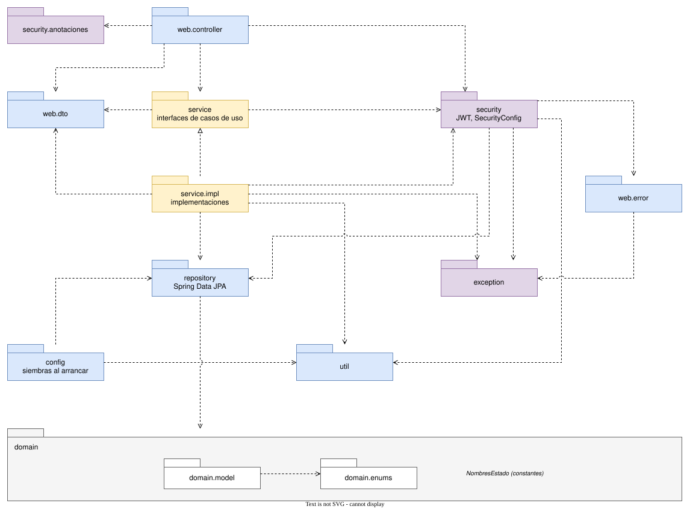

# API de Propiedad Horizontal

API REST para administrar un conjunto residencial: personas, inmuebles, vehículos, parqueaderos, visitantes, correspondencia, zonas comunes, reservas, mantenimientos y PQRS. Proyecto de la Universidad Simón Bolívar.

**Stack:** Java 25 · Spring Boot 4.1 · PostgreSQL + Flyway · Spring Security con JWT · JUnit 5 + H2 · Docker

El contrato de endpoints está en el repo del front (`ENDPOINTS.md`).

## Inicio rápido

```bash
./mvnw test              # pruebas (no necesitan Docker ni variables)
./mvnw spring-boot:run   # desarrollo: copia .env.example a .env; compose.yaml levanta PostgreSQL
```

Entra con `POST /api/auth/login` (`{ "correo", "contrasena" }`) y usa el `accessToken` como `Authorization: Bearer <token>`. El primer administrador se crea con `BOOTSTRAP_ADMIN_CORREO` y `BOOTSTRAP_ADMIN_CONTRASENA`.

## Arquitectura

Flujo: `Controller → Service (interfaz) → Repository → Entidad`, sin saltarse capas.

### Diagrama de componentes


### Diagrama de paquetes



Errores: **400** validación · **401** sin token · **403** sin permiso · **404** no existe · **409** duplicado o con historia · **422** regla de negocio.

## Seguridad

- **Sin sesión:** cada petición se valida solo con el JWT.
- **Autorización por etiqueta** (`@SoloAdministrador`, `@SoloVigilante`…) en cada endpoint; una prueba falla si falta alguna.
- **Secretos** solo en `.env` o en las variables del servidor, nunca en el repo.

## Casos de uso

| Módulo | Casos de uso |
|---|---|
| Transversal | CU-001 sesión · 002 contraseña · 003 datos propios · 004 notificaciones · 005 cuentas · 006 catálogos · 007 configuración |
| Administración | CU-008 personas · 009 inmuebles · 010 vínculos · 011 mis inmuebles · 012 vehículos · 013 consulta por placa · 014 parqueaderos |
| Seguridad | CU-015 pre-registro · 016–017 ingreso de visitantes · 018 parqueadero de visitante · 019 salida · 020 visitantes dentro · 021 historial |
| Operaciones | CU-022–023 correspondencia · 024 zonas comunes · 025–027 reservas · 028 mantenimientos · 029–031 PQRS |

Todas las entidades se pueden borrar solo si no tienen historia; si la tienen, se desactivan, cancelan o anulan.

### Diagramas de secuencia

<details>
<summary><b>Arranque y seguridad</b> (5)</summary>

**Arranque de la aplicación**


**CU-001 Iniciar sesión**


**Petición autenticada y autorización por etiqueta**


**CU-002 Cambiar contraseña**


**CU-002 Restablecer contraseña por correo**


</details>

<details>
<summary><b>Notificaciones y perfil</b> (3)</summary>

**CU-004 Generar notificaciones y correo por evento**


**CU-004 Consultar notificaciones propias**


**CU-003 y CU-011 Datos propios y mis inmuebles**


</details>

<details>
<summary><b>Administración</b> (8)</summary>

**CU-008 Alta de persona con verificación de correo**


**CU-008 Editar, desactivar y borrar personas**


**CU-009 y CU-010 Inmuebles y vínculos**


**CU-012 y CU-013 Vehículos y consulta por placa**


**CU-014 Parqueaderos**


**CU-005 Cuentas de usuario**


**CU-006 Catálogos**


**CU-007 Configuración**


</details>

<details>
<summary><b>Control de accesos</b> (5)</summary>

**CU-015 Pre-registro de visitantes**


**CU-016 Ingreso con pre-registro**


**CU-016 y CU-017 Ingreso sin pre-registro**


**CU-018, CU-019 y CU-020 Parqueadero de visitante y salida**


**CU-021 Historial de accesos**


</details>

<details>
<summary><b>Operaciones del conjunto</b> (6)</summary>

**CU-022 y CU-023 Correspondencia**


**CU-029, CU-030 y CU-031 PQRS**


**CU-024 Zonas comunes**


**CU-025 y CU-026 Reservar una zona común**


**CU-027 Gestionar reservas**


**CU-028 Mantenimientos**


</details>

<details>
<summary><b>Mecanismos compartidos</b> (2)</summary>

**Borrado físico solo sin historia**


**Máquina de estados por datos**


</details>

## Variables de entorno

| Variable | Uso |
|---|---|
| `JWT_SECRET` | **Obligatoria** (≥ 32 caracteres): firma de los tokens |
| `SPRING_DATASOURCE_URL`, `_USERNAME`, `_PASSWORD` | Base PostgreSQL en producción |
| `BOOTSTRAP_ADMIN_CORREO`, `BOOTSTRAP_ADMIN_CONTRASENA` | Primer administrador |
| `GOOGLE_CLIENT_ID`, `GOOGLE_CLIENT_SECRET`, `GMAIL_REFRESH_TOKEN` | Correo por Gmail API (si hay refresh token) |
| `MAIL_HOST`, `MAIL_PORT`, `MAIL_USERNAME`, `MAIL_PASSWORD`, `MAIL_REMITENTE` | Correo por SMTP / remitente |
| `FRONTEND_URL_RESTABLECER` | Página del front para restablecer contraseña |

## Despliegue

`Dockerfile` listo para cualquier host con Docker (por ejemplo Render); Flyway crea el esquema en una base vacía. GitHub Actions corre las pruebas y compila la imagen en cada push.

<details>
<summary>Configurar el correo con la Gmail API</summary>

1. En Google Cloud, habilita la Gmail API y crea un cliente OAuth (`GOOGLE_CLIENT_ID`, `GOOGLE_CLIENT_SECRET`).
2. Con la cuenta emisora, autoriza el scope `https://www.googleapis.com/auth/gmail.send` y guarda el refresh token en `GMAIL_REFRESH_TOKEN`.
3. Pon esa cuenta en `MAIL_REMITENTE` y pasa la pantalla de consentimiento a **In production** (en *Testing* el token caduca a los 7 días).

</details>

<details>
<summary>Editar los diagramas</summary>

- Componentes y paquetes: abre los `.drawio.xml` de [`docs/diagramas/fuente`](docs/diagramas/fuente) en [draw.io](https://app.diagrams.net) y exporta el SVG a `docs/diagramas/svg`.
- Secuencia: los `.json` de la misma carpeta se generan con [Archify](https://github.com/tt-a1i/archify) (`archify finalize sequence <json> docs/diagramas/html/<nombre>.html`), se exportan como **SVG (claro)** y se limpian con `python docs/diagramas/fuente/quitar-fondos-etiquetas.py`.

</details>
